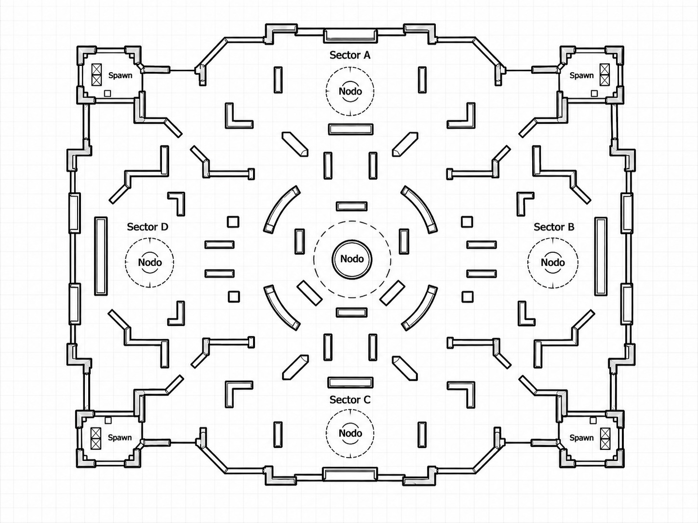

# Mapas — Una arena base y variantes por semilla

**A diseña una arena base. B convierte ese diseño en un mapa procedural con variaciones controladas.** Los cinco nodos son cinco posiciones dentro de esa arena. No se necesitan dos arenas, cinco mapas ni un generador de laberintos.

Esta guía complementa [game-design.md](game-design.md) y [contracts.md](contracts.md). La geometría definitiva se aprobará con el boceto de A; las reglas de generación quedan fijadas aquí.

## Boceto de referencia recibido

El boceto aportado por el equipo ubica el centro y cuatro nodos cardinales: **sector A al norte, B al este, C al sur y D al oeste**, con apariciones en las cuatro esquinas. Sus IDs son center, north, east, south y west; este trazado sustituye la propuesta inicial de nodos diagonales. El orden es centro -> A -> B -> C -> D.

Se conserva como referencia de distribución, no como geometría final. A/B aún deben fijar posiciones, escudos y grupos variables. Para la cuadrícula de trabajo se simplificarán las coberturas; curvas/diagonales dibujadas no implican un nuevo sistema de colisiones. A debe coordinar esa adaptación antes de producir arte que prometa huecos o paredes distintos de los tiles sólidos.

El círculo central aparece mayor en el dibujo, pero todos mantienen radio inicial 64 en las reglas; cualquier ajuste de tamaño se acuerda y comprueba durante playtesting. Hay un [fixture de formato](../shared/fixtures/README.md) con coordenadas ilustrativas, sin sustituir la plantilla definitiva.

## Plantilla provisional implementada en B3

`server/src/game/maps/arena-template.js` contiene `cardinal-sketch`, versión 1: nodos cardinales, cuatro apariciones en esquinas, dos escudos y coberturas simplificadas. Hay cuatro grupos con dos variantes cada uno (16 combinaciones), con rutas centrales y periféricas protegidas. Esto permite avanzar el servidor mientras A termina la geometría; no acredita balance final.

El generador prueba hasta 16 candidatos deterministas, valida espacio/accesos/conectividad y usa la primera variante de cada grupo como fallback validado. Registra `MAP_FALLBACK` si lo necesita. Las pruebas cubren 64 semillas con más de una geometría y sin fallback en esa muestra, además de forzar y comprobar el fallback.

A entrega ajustes de paredes, rutas, nodos, apariciones y variantes a B sobre esta plantilla. B actualiza los datos, incrementa templateVersion si cambia la geometría y vuelve a comprobar las semillas. Si cambia el algoritmo, incrementa generatorVersion. El cliente siempre dibuja el mapa resuelto recibido; ver [game-server.md](game-server.md).

## Entregable completo de A

Una vista cenital sobre cuadrícula de **24 × 16 casillas**, cada una de 32 unidades. Origen arriba a la izquierda; x crece a la derecha e y hacia abajo. Se acepta dibujo anotado con coordenadas: B ayuda a traducirlo a datos, sin exigir que A programe el generador.

El diseño debe señalar:

1. Paredes permanentes y suelo transitable, separados de la decoración.
2. Centros de los cinco nodos: `center`, `north`, `east`, `south`, `west`. Mostrar sus círculos de radio 64.
3. Al menos cuatro candidatos de aparición/reaparición, repartidos fuera de las zonas de control.
4. Posiciones propuestas de recogidas de escudo, fuera de las zonas de control.
5. Rutas principales y laterales que conectan nodos, apariciones y recogidas.
6. Áreas protegidas donde el generador nunca puede añadir paredes.
7. Grupos de obstáculos variables. Cada grupo tiene variantes permitidas dibujadas; por ejemplo, cobertura horizontal o vertical dentro de la misma zona.
8. Una combinación de obstáculos conocida y válida que sirva como fallback.

Las coordenadas de nodos, apariciones, recogidas y áreas protegidas quedan fijas en la primera versión. Solo cambian los grupos de cobertura seleccionados. Cambiar colores o efectos no cuenta como variación de jugabilidad.

## Criterios del trazado

- Todos los nodos y puntos de aparición deben ser alcanzables entre sí y desde las recogidas, considerando el radio 10 del jugador.
- Cada nodo debe tener al menos dos accesos por lados distintos; evitar un único cuello de botella. A y B revisan estos accesos también en las variantes permitidas.
- Reservar suelo libre para los círculos de control. Ninguna pared, incluso procedural, puede invadirlos.
- Priorizar pasillos principales de al menos dos casillas de ancho. No crear huecos visualmente transitables que el jugador no pueda recorrer.
- Incluir recorridos periféricos: ir de un nodo lateral a otro no debe obligar siempre a pasar por el centro.
- Usar coberturas para cortar líneas de tiro; evitar una posición que domine los cinco nodos.
- Separar apariciones y evitar reaparecer encima de alguien. El servidor elige entre candidatos válidos según ocupación y distancia a rivales; no se promete inmunidad de aparición.
- Mantener legibles los accesos y proyectiles en teléfono horizontal. Decoración no sólida debe distinguirse de paredes sólidas.

La conectividad por sí sola no demuestra equilibrio o diversión. Después de validar el mapa, se prueba con 2 y con 4 personas para revisar recorridos, coberturas y ventajas de aparición. No ampliar el número de arenas antes de cerrar esto.

## Trabajo completo de B

1. Convertir el boceto aprobado en una plantilla de datos: identificador, versión, tiles fijos, nodos, apariciones, recogidas, espacios reservados y variantes de obstáculos.
2. Implementar un PRNG con semilla uint32; no usar `Math.random()` para la geometría. La misma semilla, plantilla y versión de generador producen el mismo mapa.
3. Elegir variantes dentro de los grupos autorizados. Se modifica cobertura real manteniendo la identidad del diseño.
4. Validar dimensiones, tiles, límites, separación de elementos y zonas protegidas. Comprobar transitabilidad con espacio para el jugador y los accesos previstos.
5. Probar candidatos con un límite de intentos determinista. Si ninguno es válido, usar el fallback y registrar el motivo para poder corregir el diseño/generador.
6. Enviar el mapa completo validado al comenzar o reconectar. El cliente dibuja esos datos; no genera otro mapa por su cuenta.
7. Guardar semilla, templateId, templateVersion y generatorVersion en el resultado para poder reproducirlo con esa versión del código.

El fallback es una salida excepcional. Si muchas semillas terminan en él o siempre generan la misma geometría, la generación necesita corregirse. No se exige que todas las semillas distintas produzcan mapas únicos: hay un conjunto finito de variantes.

## Pruebas y reparto

- B automatiza reproducibilidad y validez sobre una muestra de semillas; incluye una comprobación de que la muestra produce más de una geometría y que el fallback es válido.
- A y B comprueban los accesos y la lectura visual; A renderiza paredes y nodos del mapa recibido.
- C integra estas pruebas en CI y persiste los identificadores de reproducción, sin implementar un segundo generador.
- La seed de `POST /api/test/seed` genera resultados sintéticos para evaluar la base; no equivale a crear o simular 1000 mapas/partidas online.

## Momento en que se considera terminado

Hay un boceto aprobado con todas las capas, una plantilla versionada, variantes reproducibles que afectan cobertura, validación automática y fallback probado. Dos clientes ven las mismas paredes. Las paredes permanecen al cambiar el nodo activo. Es posible desplazarse entre todos los objetivos y terminar una ronda sin atascos ni zonas inaccesibles.
